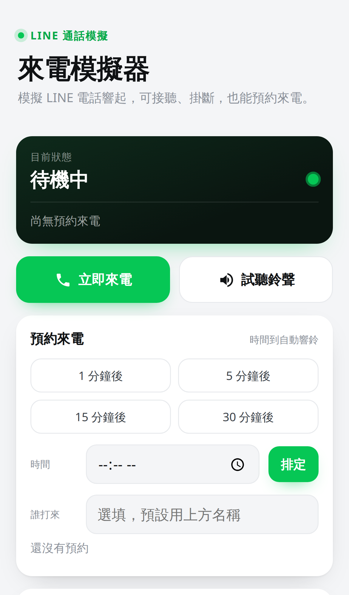

# 來電模擬器 (LINE Call Simulator)

模擬 LINE 來電畫面的 PWA：接聽、掛斷、預約來電。可加到 iPhone 主畫面，全螢幕執行。

## 安裝到 iPhone

1. 用 **Safari** 開啟 https://share543.github.io/line-call-sim/
2. 點下方「分享」圖示 → **加入主畫面**
3. 從主畫面啟動（全螢幕、無網址列）



> Chrome / Edge 在 iOS 上無法「加入主畫面」，一定要用 Safari。

## 功能

- **立即來電**：按下立刻響鈴（同時解鎖音訊），用來測試鈴聲／畫面
- **接聽 / 掛斷 / 拒接**，通話中計時、靜音與擴音按鈕狀態
- 若 iOS 擋住自動播放，來電畫面會出現「點一下播放鈴聲」提示
- **預約來電**：1/5/15/30 分鐘快捷，或指定時刻（已過的時刻自動排到隔天）
- **響鈴秒數** 5–60 秒，逾時自動記為未接
- **最近通話**紀錄（已接聽／未接／已拒接，含通話長度），存在 localStorage
- 深色模式自動跟隨系統

## 已知限制（iPhone 瀏覽器限制，非程式問題）

- 網頁無法在**背景**準時響鈴。App 開著時預約會準時響；切到別的 App 後 iOS 會暫停 JS。
  切回來時若時間已過，會**立刻補響一次**，不會默默錯過。
- 不支援真正的螢幕鎖定來電畫面（那是系統 API，iOS 不開放給網頁）。
- iOS Safari 沒有 Vibration API，「震動」只在支援的裝置上有效。
- 鈴聲是 Web Audio 即時合成的雙音來電音，非 LINE 原始音檔。

## 本機開發

```bash
cd line-call-sim
python3 -m http.server 8777
# 開 http://127.0.0.1:8777/
```

## 更新後看不到新版？

Service worker 採 network-first，但仍可能拿到快取。Safari 開網址後下拉重新整理，
或把主畫面圖示刪掉重加一次。

## 檔案

```
index.html            主程式（HTML + CSS + JS，無依賴）
manifest.webmanifest  PWA 設定
sw.js                 Service worker（離線快取）
icons/                主畫面圖示
```
